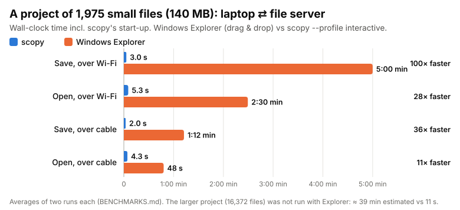
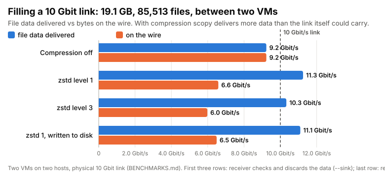
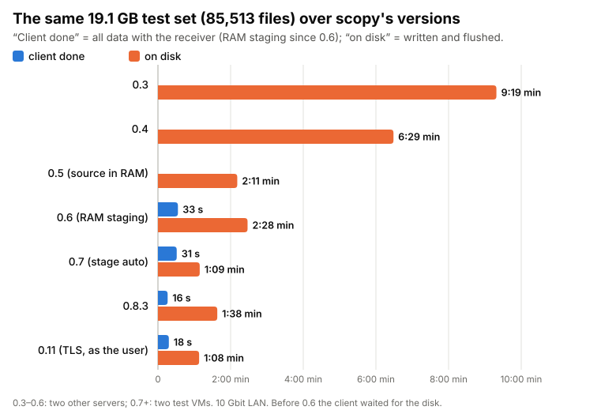
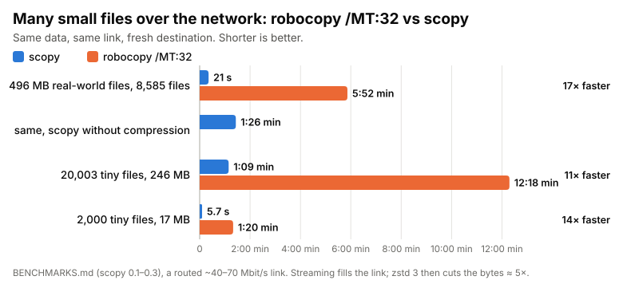
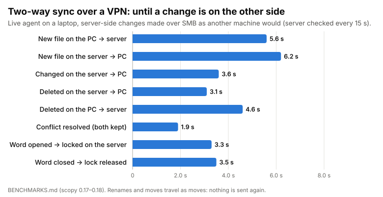

<p align="center"></p>

# StreamCopy (`scopy`)

[](https://github.com/fsaritome/StreamCopy/actions/workflows/build.yml)

Copies many small files to or from a network share as one compressed stream instead of thousands of
SMB round trips — and keeps folders in sync between PCs, terminal servers and the file server.

> **Written with AI, designed by a human.** Nearly all of the code, tests and docs were written by an AI
> (Claude) in long working sessions; the ideas, the requirements, every design decision and every test on real
> hardware came from a human, and every claim here was measured. It works well — but it has not had a human
> code review yet, so read it with that in mind. Research and development
> project, non-commercial licence (see below).

<p align="center"></p>

<p align="center"></p>
<p align="center"></p>
<p align="center"></p>
<p align="center"></p>
<p align="center"></p>

On a 10 Gbit LAN (two Windows Server VMs on different hosts, measured with 0.8.7; TLS since 0.9 adds ~1–2 s, details in
[BENCHMARKS.md](BENCHMARKS.md)):

| Test | Result |
|---|---|
| 85,513 files / 19.1 GB (a real-world file set incl. one 7.3 GB zip), `--stage auto` | **received by the server after 16 s** (~1.2 GB/s of data, 5,300 files/s); everything flushed to disk after 1:36 |
| startup before the first byte (scan 85,513 files, plan, 37,897 folders) | **1.6 s** |
| a laptop over Wi-Fi (with antivirus), save a project of 1,975 files / 140 MB to the server | Explorer **5:00**, scopy **2–4 s** (opening: 2:00–2:54 vs 4–6 s); over cable Explorer 1:12 vs scopy 2.0 s |
| hard power-cut of the receiver in the middle of a job, then the same copy again | all files SHA-256-identical to the source; the client gives up within 22–48 s instead of hanging |

On a routed ~40–70 Mbit/s link:

| Test | Result |
|---|---|
| 20,003 tiny files (avg 12 KB), no compression | 69 s vs 738 s for robocopy `/MT:32` (**10.7×**) |
| 496 MB of small text files (8,585 files), same run back to back | robocopy `/MT:32` **351.9 s** · scopy no compression **86.1 s (4.1×)** · scopy zstd 3 **21.2 s (16.6×)** |
| same data, pull back from the server | 12.5 s, 40 MB/s effective |
| the whole set, 85,513 files / 19.1 GB (incl. one 7.3 GB zip), `--order small-first` | all 85,128 smaller files in ~11 min vs ~35 min with 0.1 (**3.2×**); whole job **35:55 vs 56:11** (1.56×), 11.0 GB on the wire instead of 19.1 GB. The zip goes at raw link speed for any tool. |

## Scope and goals

**scopy is a fast file transfer and sync engine for organisations with many files.** It moves and syncs large
folders as compressed streams instead of file by file — much faster than SMB, Explorer, robocopy or classic sync
clients, above all between sites — while access stays checked by SMB with the user's own rights. The data stays
on your own file servers.

| Who | How | What for |
|---|---|---|
| **Users** (engineers, project teams, field staff) | background sync of project folders; later a tray app / Explorer integration | work locally on big project folders, changes reach the server on their own |
| **Teams / branch offices** | folders synced between sites | the same project state in every office, without DFS-R pain |
| **Admins** | CLI, service, scheduled tasks | migrations, backups, seeding new servers, bulk moves |

| Workload | Benefit | Mode | Status |
|---|---|---|---|
| Project folders user PC ↔ server (CAD, code, documents, many small files) | ★★★ seconds instead of minutes, works offline | sync | two-way sync works (in development); copy both ways (`send` / `get`) |
| Site ↔ site (branch, head office, DR) | ★★★ latency and bandwidth weigh most: 5–17× measured | sync / copy | copy works; sync in development |
| Server → server: migration, consolidation, new file server | ★★★ main use today | copy | works (19 GB / 85k files: received in 16 s, on disk in ~1:40) |
| Backup to a second server or site | ★★ only changes travel; RAM staging finishes jobs early | copy / sync | works (`bulk`, `--stage`) |
| Mobile users over VPN | ★★ compression, few round trips | sync | in development (tested over a VPN) |
| Seeding DFS-R / new replicas | ★★ much faster initial load | copy | possible, not tested |
| A few big files (ISOs, VMDKs, zips) | ✗ SMB3 / robocopy are as fast | — | not a target |

Compared with **SMB / Explorer / robocopy**: streams instead of a round trip per file, compression, self-tuning,
same permissions. With **DFS-R**: chosen folders instead of whole shares, a much faster first sync, visible
status (received / committed / conflict). With **OneDrive / SharePoint sync**: data stays on your own servers,
built for many and big files.

Done so far (open work in the [issues](https://github.com/fsaritome/StreamCopy/issues)): TLS bound to the SMB proof, writing as the user via Kerberos, two-way
sync with conflicts, deletes, moves, resume and open-file locks, a server-side change feed, a tray app, Linux (SSH
mode, a daemon with sync, Unix metadata). Next: NAS and macOS, tests with real users — and a human code review.

## Usage

On the machine that hosts the share (allow it through the firewall when Windows asks):

```
scopy serve                             # shares are discovered automatically (registry / smb.conf)
scopy serve --share photos=D:\Photos    # add/override a mapping
scopy serve --log C:\scopy\serve.log    # log to a file instead of the console
scopy serve --allow-sink                # test receivers only: accept `send --sink` benchmark jobs
```

On your PC:

```
scopy send C:\src \\server\share\folder     # push: contents of C:\src land in folder
scopy get  \\server\share\folder D:\dst     # pull: contents of folder land in D:\dst
```

| Option | Default | Meaning |
|---|---|---|
| `--profile <bulk\|interactive\|sync>` | `bulk` | Defaults for the kind of job. **bulk**: max throughput, everything tuned automatically. **interactive**: 4 streams, small files first, 4 readers / 8 writers, zstd 1 — light on servers, quick feedback. **sync**: 2 streams, 2 readers / 4 writers — minimal impact. Explicit options override the profile. |
| `--stage <MB\|auto>` | `0` (off) | Push: the receiver takes up to this much into RAM and writes in the background (for UPS-backed servers). `auto` = half the receiver's free RAM, 256 MB–16 GB. The client is told **received** (all in server RAM) and then **committed** (written and flushed to disk, verified if asked). After a crash or restart, `scopy status` reports the job as **interrupted**; run the copy again (see *Crash safety*). |
| `--detach` | off | Push: return after **received**; check the outcome later with `scopy status <server> <job-id>` (committing / committed / interrupted). |
| `--readers N`, `--writers N` | auto | Fix the reader (source) / writer (destination) thread count; default is hill-climbing on scopy's own throughput. |
| `--disk-order <auto\|on\|off>` | auto | Read in on-disk order (NTFS file ID / inode) when a sampled read latency shows a cold spinning-disk source. |
| `--compress <1-19\|off\|auto>` | `auto` (bulk), `1` (interactive), `3` (sync) | zstd level. `auto` starts at 1 and moves between 1 and 9 every 5 s from scopy's own signals: harder while the streams wait on the link, the CPU has room and the receiver keeps up (live feedback from the receiver's writer queue / RAM stage); lighter while compression takes most of the streams' time. Push only (a pull uses 1). Already-compressed types (zip, 7z, jpg, pdf, docx…) are always sent as-is, and types that turn out not to shrink stop being compressed. |
| `--order <auto\|small-first\|mixed>` | `auto` | Send order. `small-first`: compressible small files, then already-compressed small files, then big files. `mixed`: big files interleaved by byte share. `auto`: starts small-first, measures the wire rate with and without big files mixed in, and mixes only if that's ≥15% faster (i.e. something other than the link limits the small files); re-checks every minute. |
| `--dict` | off | Train a shared zstd dictionary for many small files (measured: no gain on real data so far). |
| `--verify` | off | BLAKE3-check every piece after it is written (read back from disk). |
| `--force` | off | Copy everything, even files that already match by size and modified time. |
| `--no-meta` | off | Only keep the modified time (skip creation time, attributes, folder times). |
| `--sink` | off | **Benchmark only** (push): the receiver takes in, decompresses and checks everything (BLAKE3 in memory with `--verify`) and creates the folders, but discards the file data — **nothing is written**. Measures network, CPU and protocol without loading the storage. The report says `SINK`. Only accepted by a receiver started with `--allow-sink`; numbers come out a little optimistic, because the receiver's writers don't compete for CPU. |
| `--retries N` | `2` | Extra rounds for files that didn't arrive completely. |
| `--streams N` | `8` | Parallel TCP connections. |
| `--progress S` | `5` | Seconds between progress lines. |
| `--host IP`, `--port P` | from UNC, `7788` | Where the receiver listens. |
| `serve --writers N` | — | Accepted for older service command lines; writers are tuned per job (or fixed by the client's `--writers`). |

### Windows service

From an elevated prompt on the server:

```
scopy service install --share data=D:\Data     # installs + starts, runs as LocalSystem, logs next to the exe
scopy service install --allow-sink            # test receivers only (see --sink)
scopy service uninstall
```

### Sync (in development, test receivers only)

```
scopy sync enable --server fileserver --folder Downloads   # as the user: the receiver creates the user's folders
scopy sync run                                          # mirror and watch (by hand)
scopy sync service install                              # elevated, on the PC: starts `sync run` for each user at logon
```

The receiver needs a `scopy.toml` next to scopy.exe (`[sync] root = 'D:\sync\users'`, `folders = [...]`);
see [DESIGN-SYNC.md](DESIGN-SYNC.md). The PC's agent logs to `%LOCALAPPDATA%\scopy\sync.log`.

The tray app `scopyw.exe` (`cargo build --release --features gui`, next to scopy.exe) is started by the service in
each session: a status light in the notification area (green up to date, blue syncing, orange paused, red
retrying, grey not running), a menu (sync now, pause/resume, open folder/log) and a status window.

Two-way: changes on the PC go up within seconds; changes on the server (another PC, a terminal server, a copy onto
the share) come down within about a second: the receiver watches the user's folders and tells the PC (its change
feed; the timed check in Options is only a safety net while the feed is connected). Big folders stay quick: a round
fetches only what changed on the server, and with 20,000 files a change on the share is on the PC in about 1.3 s. Deletes are synced both ways into a recycle bin (server:
`.scopy-recycle` next to the user's folders; PC: `%LOCALAPPDATA%\scopy\recycle`), kept 30 days (`recycle_days` in the
receiver's scopy.toml and in the tray's Options; 0 = for ever). Renamed or moved files and folders
are moved on the other side, not sent again — both ways (a rename on the share is a rename on the PC). A file changed on both sides keeps the server's version under its name and
this PC's as `name (conflict PC time).ext`. A file a program has open is never deleted, replaced or renamed under
it: that waits until it is closed (the tray shows "Waiting for open files"), and if it was saved meanwhile, the change
wins. An Office document open on a PC is locked on the server for everyone else (like a file open on a share): Word
on a terminal server or another PC opens it read-only ("locked for editing by …") until it is closed, or until the
lease (`lock_minutes` in the receiver's scopy.toml, 120 min) runs out after the PC went silent. The tray's Options: server check interval, ask before deleting many files
(off by default), which folders sync.

### Linux: SSH mode

Between Linux machines scopy works like rsync: SSH is the way in, no Windows, no AD, no service.

```
scopy send /data/src user@host:/data/dest      # copy a folder to another machine
scopy get user@host:/data/src /data/dest       # and back
```

The client starts `scopy session` on the other machine through SSH, so it runs there **as your user** with your
permissions (`scopy` on its PATH, or set `SCOPY_REMOTE` to its path). That session announces a port, a one-time
token and its certificate fingerprint over SSH; the files then go over scopy's parallel TLS streams, which accept
only that certificate and that token. The session ends when the copy is done. The release has a static x86_64 Linux binary
(`StreamCopy-X.Y.Z-linux-x64.tar.gz`, runs on any distribution); put `scopy` on both machines.

**What arrives** (0.25, as with `rsync -a`): contents, modification times (to the nanosecond, also of folders and
links), the full mode (rwx for owner/group/others, setuid, setgid, sticky; read-only and no-write folders too), and
**symbolic links as links** (relative, absolute or dangling; never followed, neither when reading nor when writing).
A file whose mode changed on the source but whose contents didn't is fixed without being sent again. **Owners and
groups** arrive when the receiving side runs as root: `SCOPY_REMOTE="sudo -n scopy"` (like rsync's
`--rsync-path="sudo rsync"`); as a normal user the group is kept where you are a member of it. As with rsync, owners
and groups are **matched by name**: a file of `alice` belongs to the receiver's `alice`, whatever her id is there;
ids without a name on either side, and root, keep their number. `--numeric-ids` keeps all of them by number. (The
static Linux binary reads names from /etc/passwd and /etc/group only, not from LDAP/SSSD.) Not carried: hard links (each becomes its own file, as without `rsync -H`), devices, sockets and
pipes (skipped with a warning), ACLs and extended attributes. Measured against `rsync -a` on a tree with all of
these, as a normal user and as root: every entry identical to the source in type, mode, owner, group, time and link
target (rsync itself got the times of three links wrong by up to a second: it compares times to the second).

**Linux daemon** (for sync, and copies without starting scopy per job): install it as a systemd service with
`sudo scopy service install --share name=/path` (from where the binary stays, e.g. /usr/local/bin; log:
`journalctl -u scopy`; `scopy service uninstall` removes it) or run `scopy serve` as root; users sign in through SSH — `ssh host scopy token` asks the daemon over a local socket, the kernel tells
it who is asking — and every file is then read and written **as that user** (`scopy send dir user@host::share/path`,
rsync's daemon syntax). Sync: `/etc/scopy/scopy.toml` with `[sync] root = …` and `folders = […]`, then on the PC
`scopy sync enable --server user@host::` and `scopy sync run`. Sync covers files and folders, not symbolic links.

The receiver never writes **through** a symbolic link: a link where a file belongs is replaced by the file (not
the file it points to), and a copy that would have to go through a linked folder is refused, also for `scopy get`.

Measured between two Linux VMs on different hosts (100,000 small files, 970 MB, cold caches, until everything is on
disk; [BENCHMARKS.md](BENCHMARKS.md)): **scopy 5.0 s**, rsync daemon ×8 in parallel 7.7 s, tar | nc ×8 in parallel 8.1 s,
fpsync ×16 14.6 s, rsync -a 36.9 s, rclone 88.5 s.

The receiver (`scopy serve`) also builds on Linux; shares are read from `smb.conf` (or pass `--share name=/path`).
Cross-compile e.g. with [cargo-zigbuild](https://github.com/rust-cross/cargo-zigbuild):
`cargo zigbuild --release --target aarch64-unknown-linux-gnu`. (Not yet tested on a real NAS.)

## How it works

1. **Access check through SMB.** Push: the server hands out a random ticket, the client writes it into the
   destination over SMB with your own credentials, and the server checks it appears on its disk. Pull: the
   server places the ticket in the source folder and the client must read it over SMB. So you can only write
   (or read) where SMB already lets you. The sync agent does this once per folder and direction and then shows the
   receiver's token for 10 minutes — accepted only together with a fresh Windows sign-in as the same user, for the
   same folder and direction (DESIGN-TLS, "Remembered access proofs").
2. **Overlap check.** The destination side drops a probe file into the deepest existing destination folder;
   if the source side finds it in its own tree, source and destination overlap and the copy is refused.
3. **Manifest and plan.** The source scans its tree in parallel and sends the full file list (path, size, times,
   attributes). The destination answers at once with what it still needs: files that already match are skipped
   (unless an interrupted earlier job may have left them without data), and big files interrupted earlier resume
   from their journal. Missing folders are created in the background while the data already flows.
4. **Data.** N parallel TCP streams carry frames. Small files are one frame each, sorted by type and folder;
   big files are split into 2 MB chunks. Work comes from two lanes (small files, big chunks) in the order chosen
   by `--order`. Each stream is one continuous zstd stream (flushed per frame), so similar small files compress
   well together.
5. **Writing.** A writer pool creates files locally, restores timestamps and attributes, and (with `--verify`)
   reads each piece back and compares its BLAKE3 hash. Big files are written to `name.scopy-part` with a
   hidden `name.scopy-journal` and moved into place when complete. At the end everything is flushed to disk
   before the job reports **committed**.
6. **Retries.** If a connection drops, the client reconnects; after each round the destination reports what is
   still missing and only that is sent again. TCP keepalive ends connections to a peer that died.

### Crash safety

Tested by power-cutting the receiver VM in the middle of jobs ([BENCHMARKS.md](BENCHMARKS.md)):
- **Committed means on disk**: one flush of the whole volume at the end (Linux: `syncfs`, any user may do it);
  on Windows without the rights for that (a normal user), each file is synced right after it is written.
- **Job records**: from the plan until its final flush, a job keeps a record (`scopy-pending\` next to the
  receiver's exe) of the files it is writing, synced to disk before any data flows. If it is interrupted, the next
  copy to the same destination re-sends those files even if size and time already match — after a power cut a file
  can keep its size and time without its data.
- **SSH mode**: the session keeps its records per user (`~/.local/state/scopy/pending`) and stays until every
  push is on disk, also after a `--detach` client has left (crash-tested with hard resets).
- **Pulls too**: `scopy get` keeps the same records on the PC (`%LOCALAPPDATA%\scopy\pending`), so a crash of the PC
  during a pull is handled the same way.
- **Big files** resume from their journal, which only ever claims chunks that were synced to disk.
- **No hanging**: a client whose receiver dies gives up within about a minute with an error; run the copy again.
7. **Report.** Phase timings, per-thread time (reading, compressing, network, creating, writing, …) and
   compression per file type, so it's clear where the time goes.

## Build

```
cargo build --release                     # target\release\scopy.exe
cargo build --release --features portable # no SIMD paths in hashing (escape hatch for odd CPUs)
```

Generic x86-64 builds only; CPU extensions (AVX2/AVX-512/BMI2) are used through runtime detection inside
zstd and BLAKE3.

## Project docs

[BENCHMARKS.md](BENCHMARKS.md) (the measurements), [DESIGN-TLS.md](DESIGN-TLS.md) (encryption and sign-in),
[DESIGN-SYNC.md](DESIGN-SYNC.md) (sync); open work is in the [issues](https://github.com/fsaritome/StreamCopy/issues).
The raw logs and the test scripts belong to a private test environment and are not part of this repository.

## Security

Since 0.9 every connection is TLS 1.3, bound to the SMB access proof so a man in the middle is refused without any
certificates ([DESIGN-TLS.md](DESIGN-TLS.md)); costs ~5–8 % on a CPU-bound 10 Gbit path. Since 0.10 the receiver stays
inside the share: it never reads or writes through a junction or symbolic link below the share root (every file it
opens is checked by its handle), administrative drive shares (C$, D$) are off unless it runs with
`--allow-admin-shares`, and `--only-share NAME` limits it to chosen shares. Since 0.11 the client signs in as the Windows user (Kerberos, bound to the TLS session)
and the receiver reads and writes **as that user**: NTFS permissions, owner and quotas apply exactly as over SMB. Don't expose port 7788 to the internet.

## License

Copyright © 2026 fsaritome.

StreamCopy is licensed under the [PolyForm Noncommercial License 1.0.0](LICENSE.md). You may use, modify
and share it for personal, research, educational and other noncommercial purposes. You must keep the
copyright notice and pass on the license terms. **Commercial use is not permitted** without a separate
license. To ask for one, open an issue or contact [@fsaritome](https://github.com/fsaritome).
